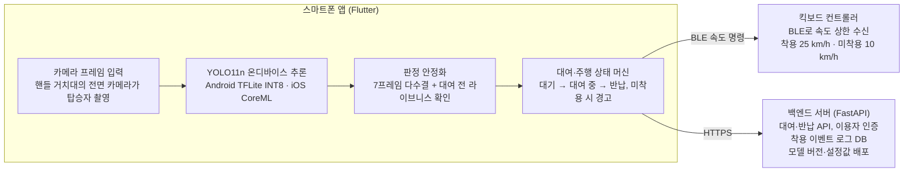
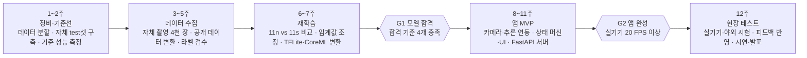

# 헬멧 프로젝트 기획서

작성일: 2026-11-22

## 개요

결론부터: YOLO11 계열은 이 서비스에 맞는 선택이지만, 지금 모델은 데이터와 평가 방식 때문에 실제 킥보드 환경에서 성능을 보장할 수 없습니다. 데이터를 교체·보강하고, 검증을 제대로 분리해 다시 학습한 뒤, 온디바이스 추론 모바일 앱으로 옮기는 것이 이 기획의 골자입니다.

**서비스 목표**: 공유 킥보드 대여 전·주행 중 헬멧 착용을 카메라로 판별해, 미착용이면 대여를 막고 주행 속도를 25 km/h에서 10 km/h로 제한합니다.

**이어받은 레포 현황**

| 항목 | 현재 상태 |
| --- | --- |
| 모델 | YOLO11n (best.pt 5.4 MB, ONNX 10.6 MB), 30 epoch 학습 |
| 클래스 | 0 Without Helmet, 1 With Helmet |
| 데이터 | 764장, 박스 1,451개 (착용 962 / 미착용 489), 대부분 400 px 폭 저해상도 |
| 보고된 성능 | mAP50 0.961, mAP50-95 0.684, Precision 0.911, Recall 0.935 |
| 실행 형태 | PC 웹캠 + OpenCV 창 데모 (키보드 R/W/Q 조작) |
| 백엔드 API·프론트엔드 | 폴더만 계획, 미구현 |
| 속도 제어 | PID 시뮬레이션 (실제 킥보드 연동 없음) |

## 현재 모델 적합성 평가

모델 구조(YOLO11n)는 적합합니다. 문제는 모델이 아니라 데이터와 평가입니다. 보고된 mAP50 0.961은 학습 데이터로 재채점한 값이라 실제 성능으로 볼 수 없습니다.

**적합한 점**

- YOLO11n은 약 2.6M 파라미터로, 모바일·엣지에서 실시간(20~30 FPS 이상) 추론이 가능한 체급입니다.
- Ultralytics는 ONNX, TFLite, CoreML 내보내기를 명령 한 줄로 지원해 앱 배포 경로가 짧습니다.
- 2클래스 단순 감지 문제라 더 큰 모델(m, l)이 얻는 이득보다 속도·배터리 손해가 큽니다.

**발견한 문제**

| 심각도 | 문제 | 근거 | 조치 |
| --- | --- | --- | --- |
| 높음 | 검증 데이터 누수 | `dataset.yaml`의 train·val·test가 모두 같은 images 폴더 | 70/20/10 분할 후 재학습·재평가 |
| 높음 | 도메인 불일치 | 학습 이미지는 멀리서 찍힌 오토바이·자전거 도로 사진, 박스 면적 중앙값이 이미지의 1.4%. 앱에서는 얼굴 가까이의 셀카·핸들 카메라 화면 | 근거리·셀카 구도 데이터 추가 수집 |
| 높음 | 오인 유도 가능성 | 모자·후드·손에 든 헬멧을 구분하는 데이터가 없음 → 대여 우회 가능 | 하드 네거티브 데이터 + 앱 단계의 라이브니스 검사 |
| 중간 | 데이터 양·해상도 부족 | 764장, 400 px 폭을 640으로 확대 학습 | 1만 장 이상으로 확대 |
| 중간 | 클래스 불균형 | 착용 962 : 미착용 489 (약 2:1) | 미착용 샘플 보강 |
| 중간 | 학습 기록 불일치 | `train.py`는 yolo11m, 실제 결과(`args.yaml`)는 yolo11n | 스크립트와 설정을 하나로 정리 |
| 낮음 | 판정 로직 버그 | `detector.py`에서 헬멧 박스가 먼저 나오면, 더 높은 신뢰도의 미착용 박스가 뒤에 와도 착용으로 판정 | 최고 신뢰도 박스 기준으로 수정, 여러 명일 때 탑승자 1명을 고르는 규칙 추가 |
| 낮음 | 플랫폼 종속 | 한글 폰트 경로가 `C:/Windows/Fonts/malgun.ttf`로 고정 | 앱 전환 시 UI는 네이티브로 이관 |

**모델 선택 권고**: YOLO11n을 기본으로 유지하고, 재학습 후 분리된 test 셋에서 YOLO11s와 비교합니다. s가 mAP50-95를 3%p 이상 올리고 대상 스마트폰에서 20 FPS를 지키면 s로 바꾸고, 아니면 n을 씁니다.

## 추가 학습용 데이터셋 추천

가장 효과가 큰 데이터는 앱 카메라 구도에서 직접 찍은 자체 데이터입니다. 공개 데이터는 양을 채우는 보조 역할로 쓰고, 최종 test 셋은 자체 데이터로만 만듭니다.

| 우선순위 | 데이터셋 | 규모 | 라이선스 | 장점 | 주의점 | 쓰임새 |
| --- | --- | --- | --- | --- | --- | --- |
| 1 | 자체 수집 (앱 카메라 구도) | 목표 3,000~5,000장 | 자체 | 실제 사용 환경과 일치, 킥보드용 헬멧·한국 환경 반영 | 촬영 동의서 필요(얼굴 = 개인정보), 라벨링 인력 | train + val + test 전체 |
| 2 | [Open Images V7](https://docs.ultralytics.com/datasets/detect/open-images-v7) ‘Bicycle helmet’, ‘Human head’ 클래스 | 전체 약 190만 장·1,600만 박스 중 클래스 필터링 | CC BY 4.0 | 근거리·다양한 각도, 필요한 클래스만 내려받기 가능 | 헬멧 박스와 머리 박스를 2클래스 정의에 맞게 재매핑, 손에 든 헬멧 검수 | 양 보강 (train) |
| 3 | [SHWD](https://github.com/njvisionpower/Safety-Helmet-Wearing-Dataset) (안전모 착용 데이터) | 7,581장, 착용 9,044 / 머리 111,514 객체 | MIT | Pascal VOC라 기존 `convert_labels.py` 재사용, 미착용 머리 샘플이 많음 | 공사장 안전모라 헬멧 모양이 다름 | 미착용 클래스 보강, 사전학습 |
| 4 | HELMET (미얀마 오토바이, [arXiv 1910.13232](https://arxiv.org/abs/1910.13232), [OSF](https://osf.io/4pwj8/)) | 910개 영상, 약 9.1만 프레임 주석, 1920×1080 | 확인 필요 | 고해상도 실제 도로 영상 | 박스가 머리가 아니라 오토바이 단위라 그대로 못 씀, 연속 프레임 중복 | 주행 중(원거리) 감지가 필요할 때만 |
| 5 | Roboflow Universe 킥보드 프로젝트 (예: [scooter_detection_Final](https://universe.roboflow.com/school-mdkgi/scooter_detection_final), 클래스 kb_with_helmet / kb_without_helmet) | 확인 필요 | 프로젝트별 상이 | 킥보드 탑승자 장면 | 규모·라벨 품질·라이선스를 개별 확인 | 검수 후 선별 추가 |
| 기존 | Kaggle BikesHelmets (현재 레포) | 764장 | 확인 필요 | 이미 YOLO 포맷 | 저해상도·원거리 | train에 유지 |

**자체 수집 시 꼭 넣을 장면**

- 착용: 킥보드·자전거용 헬멧, 턱끈 풀린 상태, 다양한 색·모양
- 미착용: 맨머리, 야구모자·비니·후드, 안경·마스크
- 하드 네거티브: 헬멧을 손에 들거나 팔에 걸친 상태, 화면 속 헬멧 사진
- 환경: 주간·야간·역광·비, 실내 거치대, 여러 스마트폰 기종

**라벨 규칙 명확화**: With Helmet은 ‘머리에 쓴 헬멧’만, Without Helmet은 ‘헬멧을 쓰지 않은 머리’(모자 포함)로 정의합니다. 손에 든 헬멧에는 박스를 치지 않고 그 사람의 머리를 Without Helmet으로 라벨합니다.

**목표 구성 (약 1만 장)**: 자체 4,000 + Open Images 3,000 + SHWD 2,000 + 기존 764 + Roboflow 선별분, 착용:미착용 박스 비율 1:1에 가깝게. 국내 AI Hub에는 킥보드 헬멧 전용 공개 데이터를 찾지 못했으므로, aihub.or.kr에서 ‘개인형 이동장치’·‘이륜차’로 한 번 더 검색해 볼 필요가 있습니다.

## 학습 계획

현재 best.pt를 시작점으로 쓰지 않고, COCO 사전학습 yolo11n.pt에서 통합 데이터로 다시 학습합니다. 기존 모델은 비교 기준(baseline)으로만 남깁니다.

1. **기준선 측정**: 자체 데이터 test 셋(500장 이상)을 먼저 만들고 현재 best.pt를 채점합니다. 이 수치가 개선 여부를 판단하는 기준입니다.
2. **데이터 통합**: 모든 데이터를 2클래스 YOLO 포맷으로 변환하고, 중복 이미지(연속 프레임 포함)를 제거합니다.
3. **분할**: train 70 / val 20 / test 10. 같은 사람·같은 영상에서 나온 이미지는 같은 분할에만 넣어 누수를 막습니다.
4. **학습 설정**: epochs 100~150, patience 30, imgsz 640, 동일 seed. 증강은 기본 mosaic·HSV에 더해 저조도·블러를 추가합니다.
5. **모델 비교**: YOLO11n과 YOLO11s를 같은 조건으로 학습하고 test 셋 성능과 기기 FPS를 함께 비교합니다.
6. **임계값 조정**: Without Helmet을 놓치는 것이 더 위험하므로, With Helmet 정밀도 우선으로 conf 임계값(현재 0.55)을 다시 정합니다.
7. **내보내기**: TFLite(INT8 양자화, Android)와 CoreML(iOS)로 변환하고, 변환 후 성능 하락이 1%p 이내인지 확인합니다.

**합격 기준 (자체 test 셋 기준)**

| 지표 | 목표 |
| --- | --- |
| mAP50 | 0.90 이상 |
| With Helmet 정밀도 (미착용을 착용으로 오판하지 않기) | 0.95 이상 |
| Without Helmet 재현율 | 0.90 이상 |
| 중급 안드로이드 기기 추론 속도 | 20 FPS 이상 |

실험 관리는 학습 스크립트의 하드코딩된 Windows 경로를 상대경로로 바꾸고, `args.yaml`과 데이터 버전을 함께 기록하는 것에서 시작합니다.

## 앱 구현 방식 추천과 아키텍처

추천하는 구조는 Flutter 크로스플랫폼 앱입니다. YOLO11n은 폰에서 직접 돌리고(온디바이스), 서버는 대여와 로그만 맡습니다. 판정은 실시간이어야 하고, 주행 중 통신이 끊겨도 동작해야 하며, 얼굴 영상을 서버로 보내지 않아야 하기 때문입니다.

폰을 거치대에 꽂으면 앱이 프레임마다 착용 여부를 판정합니다. 상태 머신은 킥보드에 속도 상한을 보내고, 서버에는 이벤트만 기록합니다.

**구현 방식 비교**

| 방식 | 추론 위치 | 장점 | 단점 | 판단 |
| --- | --- | --- | --- | --- |
| Flutter + TFLite/CoreML | 폰 | 한 코드로 Android·iOS, 실시간·오프라인 동작, 영상 외부 전송 없음, 서버 GPU 비용 없음 | 저가 기기에서 FPS 편차 | 추천 |
| React Native + VisionCamera | 폰 | JS/TS 생태계, 웹 개발자에게 익숙함 | 프레임 처리·모델 연동이 플러그인에 의존 | 대안 |
| 네이티브 (Kotlin + Swift) | 폰 | 최고 성능, 카메라 제어 자유 | 앱을 두 벌 개발 | 인력이 충분할 때 |
| 서버 추론 (FastAPI + 기존 detector.py) | 서버 | 기존 코드 그대로 재사용 | 왕복 지연, 통신 끊기면 판정 불가, 얼굴 영상 전송에 따른 개인정보 부담 | 대여 승인 스냅샷 재검증에만 |
| 웹/PWA (ONNX Runtime Web) | 브라우저 | 설치 없이 링크로 실행 | 성능·백그라운드·BLE 제약 | 시연·발표용 |

**기존 코드 재사용**

- `detector.py`의 다수결 버퍼·임계값 로직과 `speed_controller.py`의 PID는 앱(Dart)으로 이식합니다. `settings.py` 값은 서버에서 원격 설정으로 내려줍니다.
- `backend/`는 FastAPI 서버로 확장해 `api/`에 대여 시작·반납·이벤트 기록 엔드포인트를 둡니다.
- `main.py` OpenCV 데모는 모델 검증·시연용으로 남깁니다.
- 모델 연동은 Ultralytics 공식 Flutter 플러그인(ultralytics_yolo)을 먼저 검토하고, 맞지 않으면 tflite_flutter로 직접 연동합니다.

**우회 방지**: 대여 승인에는 2~3초 연속 착용 판정과 무작위 동작 요청(고개 돌리기)을 요구해 사진을 들이대는 우회를 막습니다.

**킥보드 연동**: 실제 속도 제어에는 킥보드 운영사의 IoT·펌웨어 연동이 필요합니다. 프로토타입에서는 기존 PID 시뮬레이터를 앱 안의 가상 계기판으로 보여주고, BLE 인터페이스만 정의해 둡니다.

## 일정 및 리스크

전체 12주를 가정한 일정입니다(팀 일정에 맞게 조정). 재학습 모델이 G1 합격 기준을 넘기 전에는 앱에 모델을 올리지 않습니다.

앱 MVP 개발은 3단계와 겹쳐서 시작할 수 있습니다. 현재 best.pt로 먼저 화면·흐름을 만들고 G1 통과 모델로 교체합니다.

**리스크**

| 리스크 | 영향 | 대응 |
| --- | --- | --- |
| 자체 데이터 수집이 늦어짐 | 도메인 불일치가 남아 실사용 성능 미달 | 팀원·지인 촬영 세션을 먼저 잡고, 영상에서 프레임을 뽑아 양 확보 |
| 촬영 대상자 개인정보 | 데이터 사용 불가·법적 문제 | 촬영 동의서, 학습 목적 외 사용 금지, 앱은 영상을 서버로 보내지 않음 |
| 공개 데이터 라이선스 | 결과물 배포 제약 | 데이터별 라이선스 표 작성, 불명확한 데이터는 학습에서 제외 |
| 저가 폰에서 FPS 부족 | 판정 지연·발열 | INT8 양자화, 입력 크기 320~416으로 축소, 추론 간격 조절 |
| 사진·손에 든 헬멧으로 우회 | 서비스 신뢰 하락 | 하드 네거티브 학습 + 라이브니스 확인 |
| 야간·역광·비 환경 오판 | 주행 중 잘못된 속도 제한 | 해당 조건 데이터 수집, 판정 불가 시 안전 쪽(10 km/h)으로 동작 |
| 실제 킥보드 연동 불가 | 속도 제어 시연 한계 | 가상 계기판 시뮬레이션 + BLE 인터페이스 명세로 대체 |

## 출처

- [Ultralytics — Open Images V7 문서](https://docs.ultralytics.com/datasets/detect/open-images-v7)
- [Safety Helmet Wearing Dataset (SHWD), GitHub](https://github.com/njvisionpower/Safety-Helmet-Wearing-Dataset)
- [Detecting motorcycle helmet use with deep learning, arXiv 1910.13232](https://arxiv.org/abs/1910.13232) — HELMET 데이터 규모는 검색 결과 기준, 원문 미확인
- [Roboflow Universe — scooter_detection_Final](https://universe.roboflow.com/school-mdkgi/scooter_detection_final) — 페이지 접근 차단으로 규모 미확인
- 레포 내부: `train/data/dataset.yaml`, `train/results/train7_best/`, `backend/core/detector.py`
